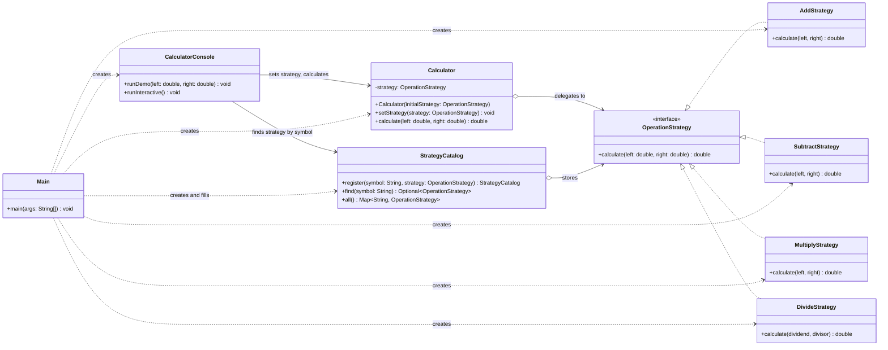

# Задание №5 — паттерн Strategy: калькулятор

**Курс:** ShP-2216 Software Design Patterns  **Студент:** _Имя Фамилия, группа_

## 1. Введение

Я выбрал вариант B — калькулятор. Задача калькулятора всегда одна: взять два числа и вернуть результат.
Меняется только способ, то есть операция. Поэтому семейство взаимозаменяемых алгоритмов здесь — это
арифметические операции: сложение, вычитание, умножение и деление.

Без паттерна такой калькулятор обычно пишут через `switch` по символу операции. Паттерн Strategy
выносит каждую операцию в отдельный класс с общим интерфейсом. Калькулятор хранит одну такую стратегию
и просто вызывает её, а сменить стратегию можно прямо во время работы программы.

## 2. UML-диаграмма классов



**Как читать диаграмму:**
- `Calculator` — это **Context**.
- `OperationStrategy` — **интерфейс стратегии**.
- Четыре класса `*Strategy` — **конкретные стратегии**.
- `CalculatorConsole` — **Client**.
- `StrategyCatalog` хранит стратегии по символам (`o-->` со звёздочкой означает «много стратегий»).
- `Main` создаёт все конкретные стратегии; больше их никто не создаёт.
- `ExpressionParser`, `Expression` и `ResultFormatter` — маленькие вспомогательные классы клиента. На диаграмме их нет, чтобы она оставалась читаемой.

## 3. Принципы Clean Code (Роберт Мартин, главы 9–11)

Все сравнения «до/после» опираются на наивную версию калькулятора, которую заменяет паттерн:

```java
public class Calculator {
    public double calculate(String operator, double left, double right) {
        switch (operator) {
            case "+": return left + right;
            case "-": return left - right;
            case "*": return left * right;
            case "/":
                if (right == 0) throw new ArithmeticException("cannot divide by zero");
                return left / right;
            default: throw new IllegalArgumentException("Unknown operator: " + operator);
        }
    }
}
```

### 3.1 Классы должны быть маленькими: принцип единственной ответственности (гл. 10, с. 136–138)

Мартин измеряет размер класса не строками, а количеством *ответственностей*. По SRP у класса должна быть
только одна причина для изменения.

У старого `Calculator` таких причин много. Его приходится менять, если меняется любая операция,
добавляется новая или меняются символы операций.

В новой версии у каждого класса одна причина для изменения:
- `DivideStrategy` меняется, только если меняется правило деления.
- `Calculator` меняется, только если меняется способ делегирования.
- Разбор ввода живёт в `ExpressionParser`, а печать — в `ResultFormatter`.

```java
public final class DivideStrategy implements OperationStrategy {

    @Override
    public double calculate(double dividend, double divisor) {
        if (divisor == 0) {
            throw new ArithmeticException("cannot divide by zero");
        }
        return dividend / divisor;
    }
}
```

Здесь хорошо видно, почему в коде не нужны комментарии: имена говорят сами за себя. Класс называется
`DivideStrategy`, параметры — `dividend` (делимое) и `divisor` (делитель). Условие `if` здесь проверяет
данные (деление на ноль), а не тип операции, поэтому требованию задания оно не противоречит.

### 3.2 Связность (cohesion) (гл. 10, с. 140)

Класс связен, если его методы используют его поля. У `Calculator` одно поле, и оба метода с ним работают:
`setStrategy` его записывает, `calculate` читает. Лишних полей, которые нужны только «одному из
case-ов», больше нет.

```java
public final class Calculator {

    private OperationStrategy strategy;

    public void setStrategy(OperationStrategy strategy) {
        this.strategy = Objects.requireNonNull(strategy, "strategy must not be null");
    }

    public double calculate(double left, double right) {
        return strategy.calculate(left, right);
    }
}
```

### 3.3 Организация для изменений: принцип открытости/закрытости (гл. 10, с. 147)

Мартин показывает на примере класса `Sql`, что каждое «открытие» класса ради новой функции — это риск
сломать то, что уже работало, и всё придётся тестировать заново. Решение — много маленьких закрытых классов.

В старой версии новая операция означает правку `switch`, то есть открытие уже протестированного класса.
В новой версии добавить, например, возведение в степень можно так:

```java
public final class PowerStrategy implements OperationStrategy {

    @Override
    public double calculate(double base, double exponent) {
        return Math.pow(base, exponent);
    }
}
```

```java
.register("^", new PowerStrategy())
```

Нужны один новый файл и одна строка в `Main`. Ни `Calculator`, ни другие стратегии, ни их тесты не
меняются. Тем самым убрано и ветвление: `switch` по символу заменён полиморфным вызовом
`strategy.calculate(...)`, а клиент находит стратегию по таблице в `StrategyCatalog`, а не через `if`.

### 3.4 Изоляция от изменений: принцип инверсии зависимостей (гл. 10, с. 149)

DIP говорит: классы должны зависеть от абстракций, а не от конкретных деталей. У Мартина класс `Portfolio`
зависит от интерфейса `StockExchange`, поэтому в тесте можно подставить заглушку
`FixedStockExchangeStub`.

Здесь всё так же: `Calculator` знает только интерфейс `OperationStrategy` и не импортирует ни одной
конкретной стратегии. Поэтому тест может подставить свою заглушку, которая всегда возвращает одно число:

```java
final class FixedResultStrategy implements OperationStrategy {

    private final double fixedResult;

    FixedResultStrategy(double fixedResult) {
        this.fixedResult = fixedResult;
    }

    @Override
    public double calculate(double left, double right) {
        return fixedResult;
    }
}
```

### 3.5 Отделение создания системы от её использования (гл. 11, с. 154–155)

Мартин советует собирать все объекты в `main`, а остальной программе позволить просто пользоваться
готовыми объектами. Все стрелки зависимостей должны идти *от* `main`.

У нас `Main` — единственное место, где пишется `new AddStrategy()` и создаются остальные объекты.
`Calculator` и `CalculatorConsole` сами ничего не создают.

```java
public static void main(String[] args) {
    OperationStrategy add = new AddStrategy();
    StrategyCatalog catalog = new StrategyCatalog()
            .register("+", add)
            .register("-", new SubtractStrategy())
            .register("*", new MultiplyStrategy())
            .register("/", new DivideStrategy());

    CalculatorConsole console = new CalculatorConsole(
            new Calculator(add),
            catalog,
            new ExpressionParser(),
            new ResultFormatter(),
            new Scanner(System.in),
            System.out);

    console.runDemo(DEMO_LEFT_NUMBER, DEMO_RIGHT_NUMBER);
    console.runInteractive();
}
```

### 3.6 Внедрение зависимостей (Dependency Injection) (гл. 11, с. 157)

При настоящем DI класс сам не добывает свои зависимости. Он принимает их через конструктор или сеттер
от «главного» кода.

`Calculator` полностью пассивен: первую стратегию он получает через конструктор, следующие — через
`setStrategy`. Именно этот сеттер и даёт **смену стратегии во время работы программы**.

`CalculatorConsole` тоже получает `Scanner` и `PrintStream` снаружи, а не обращается к `System.in`
напрямую. Поэтому тест `CalculatorConsoleTest` подаёт ей свой ввод и проверяет вывод, не трогая клавиатуру и экран.

### 3.7 Чистые тесты: одна идея на тест (гл. 9, с. 124–131)

Мартин считает главным качеством теста читаемость и советует проверять в одном тесте одну идею.
Каждый тест построен по схеме «подготовка → действие → проверка», а имя теста — это готовое
предложение о том, что проверяется:

```java
@Test
void usesTheNewStrategyAfterSwitchingAtRuntime() {
    Calculator calculator = new Calculator(new FixedResultStrategy(42));

    calculator.setStrategy(new FixedResultStrategy(7));

    assertEquals(7, calculator.calculate(1, 2));
}

@Test
void divideStrategyRefusesToDivideByZero() {
    assertThrows(ArithmeticException.class, () -> new DivideStrategy().calculate(9, 0));
}
```

### 3.8 F.I.R.S.T. (гл. 9, с. 132)

20 тестов проекта соответствуют всем пяти правилам:
- **Fast** — все тесты выполняются меньше чем за секунду.
- **Independent** — тесты не делят общее изменяемое состояние, каждый создаёт свои объекты.
- **Repeatable** — нет сети, времени и случайных чисел, поэтому результат везде одинаковый.
- **Self-validating** — JUnit сам говорит «прошёл/не прошёл», ничего не нужно сверять вручную.
- **Timely** — тесты лежат рядом с кодом и пишутся вместе с каждым новым классом.

## 4. Вывод

Паттерн заменил один класс со `switch` на интерфейс, четыре маленькие стратегии и таблицу-каталог.
Файлов стало больше, и для новичка это минус.

Взамен каждую операцию можно прочитать, протестировать и изменить отдельно, в `Calculator` нет ни одного
ветвления по типу операции, а новая операция добавляется одним классом и одной строкой без правки уже
проверенного кода.

Для двух операций, которые никогда не меняются, `switch` был бы проще. Дополнительные классы окупаются
тогда, когда операций становится больше или их нужно менять на лету, как здесь.

## 5. Репозиторий

GitHub: _https://github.com/ваш-логин/strategy-calculator_
